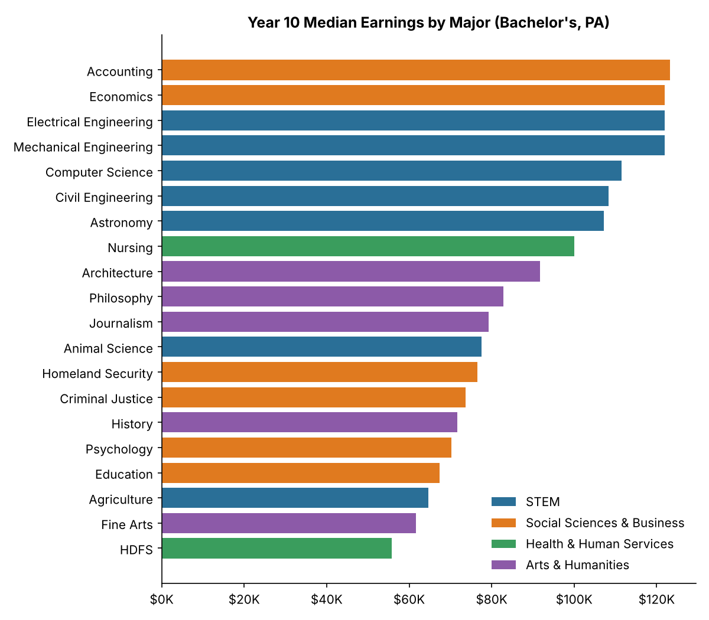
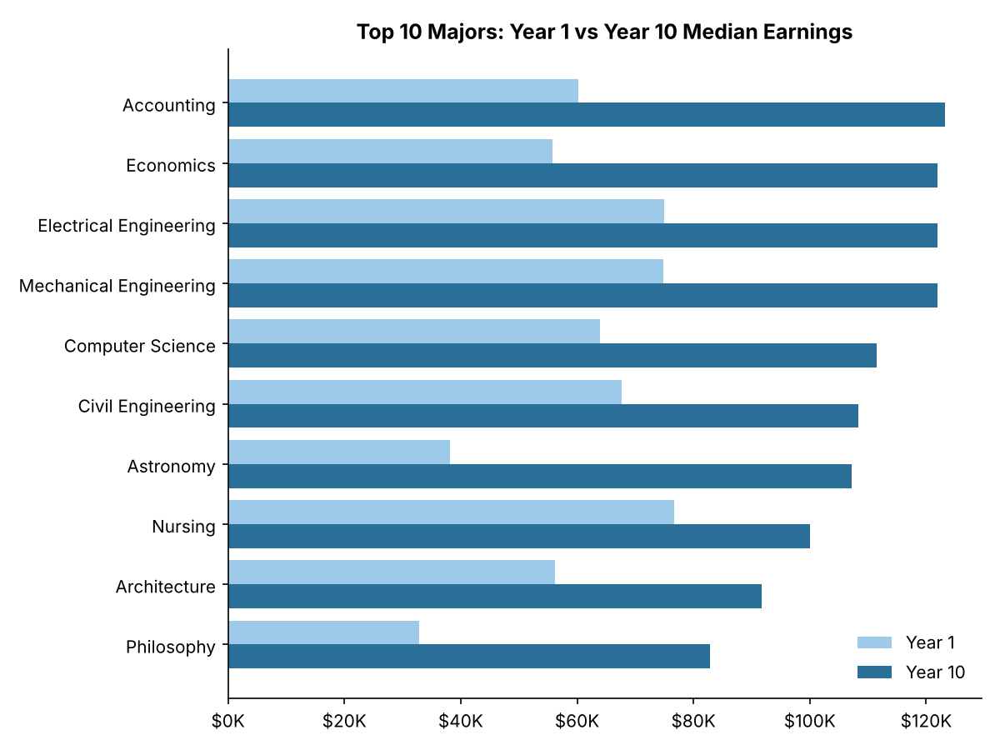
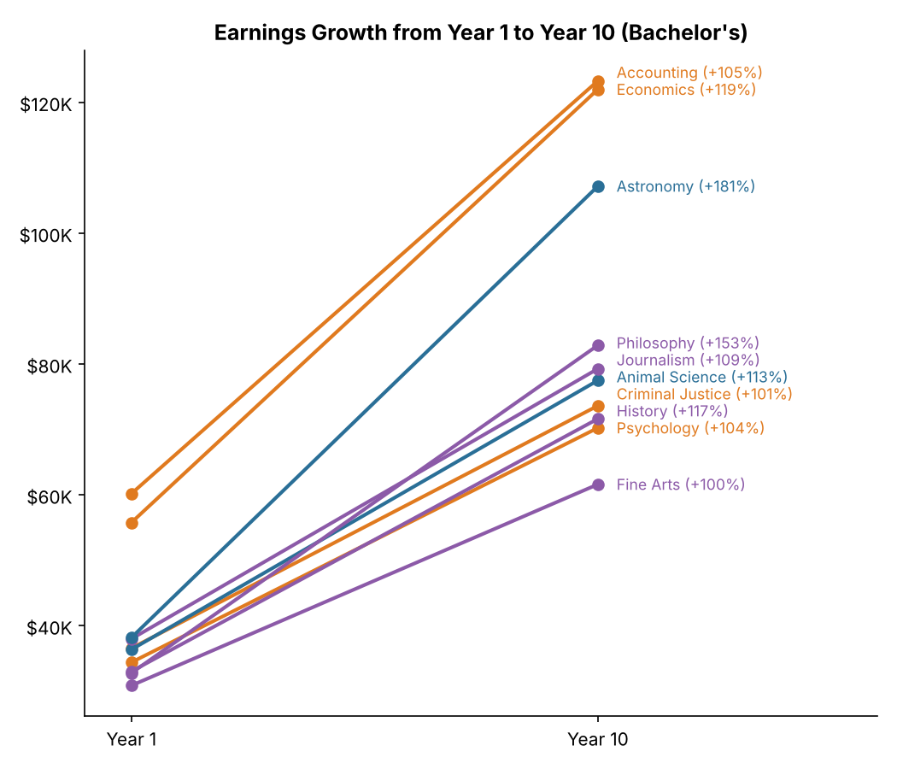
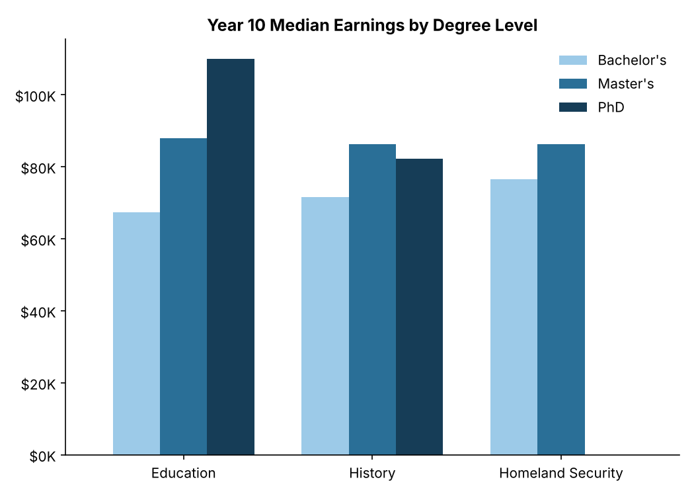
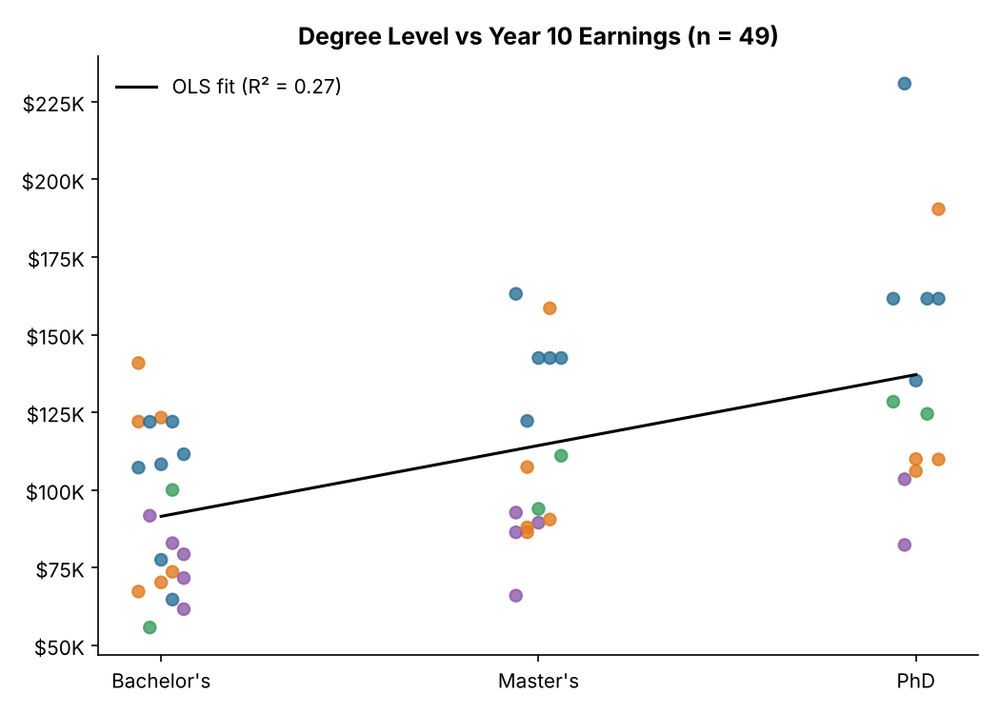

# Major Matters: Does Education Level Predict Earnings? (PSEO Analysis, Pennsylvania)

Analysis of U.S. Census Bureau **Post-Secondary Employment Outcomes (PSEO)** data for Pennsylvania institutions. It asks whether the level of degree (Bachelor's, Master's or PhD) predicts graduate earnings, and how much the choice of major matters.

Structured with the **SOAR** model (Specify, Obtain, Analyze, Report). Written for high school and undecided college students choosing a major.

[Slide deck (PDF)](docs/final_presentation.pdf) · [Final report (PDF)](docs/final_report.pdf)



## Key findings

- **Major matters more than degree level.** Degree level by itself explains about 27% of the variation in Year 10 earnings (R² = 0.27). With major added as a control, R² rises to 0.85.
- **Degree level still counts.** Each step up in degree is worth about **+$22.8K** in Year 10 median earnings in the degree-only model (p < 0.001). With major controlled it is about **+$18.9K**.
- **STEM and business lead.** At the Bachelor's level, Accounting ($123K), Economics ($122K) and Electrical/Mechanical Engineering ($122K) have the highest Year 10 earnings. HDFS, Fine Arts and Agriculture have the lowest.
- **Earnings grow a lot over the first decade.** Astronomy goes from $38K in Year 1 to $107K in Year 10 (+181%), the biggest jump of any major in the set.
- **Recommendation:** choose the major first, then decide what level of education to pursue.

| Model | n | R² | Degree-level coef. | p |
|---|---|---|---|---|
| Year 10 earnings ~ degree level | 49 | 0.27 | +$22,805 | 0.0002 |
| Year 10 earnings ~ degree level + major | 49 | 0.85 | +$18,876 | < 0.001 |

## Data

- **Source:** [U.S. Census Bureau, Post-Secondary Employment Outcomes (PSEO)](https://lehd.ces.census.gov/data/pseo_experimental.html)
- **Vintage:** PSEO Pennsylvania 2025Q4 release, covering 10,978 earnings records from 25 PA colleges and universities
- **Scope:** Pennsylvania state-level records, median (50th percentile) earnings at Year 1 and Year 10 after graduation
- **Cleaning** (done in Python and SQL):
  1. Filtered about 11,000 rows down to PA state-level records
  2. Dropped suppressed rows. The Census Bureau hides earnings for small graduating cohorts, and about 62% of the data was suppressed.
  3. Kept only the Bachelor's, Master's and PhD degree levels
  4. Narrowed 185 fields of study to 20 majors in 4 categories: STEM, Health & Human Services, Social Sciences & Business, and Arts & Humanities
  5. Ended with **49 usable major × degree observations**

| File | Description |
|---|---|
| `data/pa_major_earnings_by_degree.csv` | One row per major: Year 1 and Year 10 earnings for each degree level, plus % gain for an advanced degree |
| `data/regression_data.csv` | Long format (major × degree), the 49 observations used in the regressions |
| `data/analysis_workbook.xlsx` | Original Excel workbook: cleaned data, regression data, ToolPak regression output and chart sheets |
| `data/raw_excel_exports/` | The original Excel regression output and the chart source tables, exported unchanged |

## Repo structure

```
├── data/                  cleaned datasets (CSV)
├── src/analysis.py        reproduces the tables, regressions and charts
├── outputs/
│   ├── charts/            PNG charts
│   └── tables/            summary tables (CSV) and the full regression output
└── docs/                  final report and slide deck (.docx/.pptx plus PDF copies)
```

## Reproduce

```bash
pip install -r requirements.txt
python src/analysis.py
```

## Charts

| | |
|---|---|
|  |  |
|  |  |

## Limitations

- About 62% of the PSEO records were suppressed for privacy, which leaves many majors with data at only one degree level.
- The data covers Pennsylvania only, so the results may not hold for other states.
- Each row is a group median, not an individual record, so these numbers show trends, not individual outcomes.
- **Graduate-level data is aggregated into broader fields.** That is why Civil, Mechanical and Electrical Engineering share identical Master's and PhD values, and why some majors (e.g. Homeland Security, Economics) look like they earn less with a graduate degree.
- Correlation is not causation. People who pursue higher degrees differ in many other ways too.

### Known data notes

- History's Master's Year 10 value ($86,367) is identical to Homeland Security's Master's value. It may be a copy error, or it may come from the aggregation described above.
- `regression_data.csv` lists Homeland Security (Bachelor's) at $74,826 / $140,862, while `pa_major_earnings_by_degree.csv` has $38,940 / $76,483. The charts use the latter. The regression uses the former, matching the original Excel analysis.

## Tools

Python (pandas, statsmodels, matplotlib), SQL, Excel (Data Analysis ToolPak regression), PowerPoint


